# PetroCore Supply — ERD v1.2 Logical Proposal

**RECONSTRUCTED PROPOSAL — NOT APPROVED**

**Status:** Product-owner review draft  
**Prepared:** 2026-11-15  
**Repository branch:** `docs/database-v1.2-review-proposal`  
**Baseline:** Detailed Database Dictionary v1.1 and Consolidated Database Dictionary v1.2  
**Related:** Database v1.2 Reconciliation Report; Decision Register; proposed field-level Dictionary v1.2.

## Document control

| Field | Value |
|---|---|
| Document | ERD v1.2 Logical Proposal (reconstructed) |
| Version | Review revision 3 (owner-approved review baseline) |
| Status | Owner-approved review baseline. Authorised for Migration 1 drafting; not physical-schema approval. |
| Owner | Product owner (Tunde Oladeji) |
| Prepared | 2026-11-15 |
| Repository branch | `docs/database-v1.2-review-proposal` |
| Approval required | Owner sign-off recorded 2026-11-15 on the reconstructed model; re-verify if the original artefact is produced |
| Change record | See §8 Amendment log. |

## 1. Source and limitation

The original owner-supplied ERD v1.2 artefact was not located in the current repository or accessible Library material during preparation. This diagram is therefore a **reconstructed logical proposal**, not a claim that the original ERD has been reproduced exactly.

It is based on:
- the detailed v1.1 field-level dictionary;
- the v1.2 amendment specification;
- the repository's reconciliation report; and
- the current Decision Register.

The diagram intentionally shows core business relationships only. It is not a complete physical ERD and does not settle exact SQL types, nullability, indexes, delete actions, RLS or every table relationship.

## 2. Legend and decision status

- Entity names in the diagram are the v1.1 working names unless otherwise noted.
- `organisations` is the approved logical tenant root (D-002).
- `business_settings` remains tenant configuration, not tenant identity.
- `profiles` represents the application profile linked to Supabase Auth; exact tenant membership implementation remains open.
- `PLATFORM_ADMIN_AUTHORITY` is a conceptual security boundary, **not a proposed physical table**.
- The diagram omits `organisation_id` from many entity boxes to avoid implying that DR-24 has been resolved. Direct-versus-inherited ownership must be completed in the ownership matrix.
- Relationships involving the location hierarchy are provisional because DR-10 remains open.
- Approval rules/requests are shown as a future/open approval model; DR-20 remains open.
- No entity or relationship shown here authorises SQL.

## 3. Logical ERD

```mermaid
erDiagram
    ORGANISATIONS ||--o| BUSINESS_SETTINGS : configures
    ORGANISATIONS ||--o{ BUSINESS_LOCATIONS : owns
    ORGANISATIONS ||--o{ PROFILES : tenant_membership_candidate

    PROFILES ||--o{ USER_ROLES : assigned
    ROLES ||--o{ USER_ROLES : grants
    ROLES ||--o{ ROLE_PERMISSIONS : contains
    PERMISSIONS ||--o{ ROLE_PERMISSIONS : included
    PROFILES ||--o{ USER_LOCATION_ACCESS : receives
    BUSINESS_LOCATIONS ||--o{ USER_LOCATION_ACCESS : grants_scope

    SUPPLIERS ||--o{ SUPPLIER_DEPOTS : operates
    SUPPLIER_DEPOTS ||--o{ SUPPLIER_DEPOT_BAYS : contains
    SUPPLIERS ||--o{ SUPPLIER_PRODUCTS : offers
    PRODUCTS ||--o{ SUPPLIER_PRODUCTS : supplied_as

    SUPPLIERS ||--o{ PURCHASE_ORDERS : receives_commitment
    PURCHASE_ORDERS ||--|{ PURCHASE_ORDER_ITEMS : contains
    PRODUCTS ||--o{ PURCHASE_ORDER_ITEMS : ordered
    SUPPLIERS ||--o{ PROCUREMENT_BATCHES : source
    SUPPLIER_DEPOTS ||--o{ PROCUREMENT_BATCHES : loaded_from
    PRODUCTS ||--o{ PROCUREMENT_BATCHES : product
    PURCHASE_ORDER_ITEMS o|--o{ PROCUREMENT_BATCHES : source_line

    CUSTOMERS ||--o{ CUSTOMER_LOCATIONS : has
    CUSTOMERS ||--o{ SALES_ORDERS : places
    SALES_ORDERS ||--|{ SALES_ORDER_ITEMS : contains
    PRODUCTS ||--o{ SALES_ORDER_ITEMS : ordered_product
    SALES_ORDER_ITEMS o|--o{ PROCUREMENT_BATCHES : direct_supply_trace

    PROCUREMENT_BATCHES ||--o| INVENTORY_BATCHES : verified_storage_receipt
    BUSINESS_LOCATIONS ||--o{ INVENTORY_BATCHES : stores
    SALES_ORDERS ||--o{ INVENTORY_RESERVATIONS : reserved_for
    INVENTORY_RESERVATIONS ||--|{ INVENTORY_RESERVATION_ITEMS : contains
    INVENTORY_BATCHES ||--o{ INVENTORY_RESERVATION_ITEMS : reserved_from
    SALES_ORDER_ITEMS ||--o{ INVENTORY_RESERVATION_ITEMS : fulfils
    SALES_ORDERS ||--o{ INVENTORY_ISSUES : issued_for
    INVENTORY_ISSUES ||--|{ INVENTORY_MOVEMENTS : posts
    INVENTORY_BATCHES ||--o{ INVENTORY_MOVEMENTS : movement_source
    INVENTORY_ISSUES ||--o{ FIFO_ALLOCATIONS : allocates
    INVENTORY_BATCHES ||--o{ FIFO_ALLOCATIONS : consumed_batch

    TRIPS ||--o{ TRIP_ASSIGNMENTS : assigned
    TRUCKS ||--o{ TRIP_ASSIGNMENTS : assigned_to
    DRIVERS ||--o{ TRIP_ASSIGNMENTS : operates
    TRANSPORTERS o|--o{ TRIP_ASSIGNMENTS : provides
    TRIPS ||--o{ TRIP_SALES_ORDERS : carries
    SALES_ORDERS ||--o{ TRIP_SALES_ORDERS : allocated_to
    TRIP_SALES_ORDERS ||--|{ TRIP_SALES_ORDER_ITEMS : allocates_lines
    SALES_ORDER_ITEMS ||--o{ TRIP_SALES_ORDER_ITEMS : assigned_line
    TRIPS ||--o{ TRIP_LOADING_RECORDS : has
    TRUCK_COMPARTMENTS ||--o{ TRIP_LOADING_RECORDS : loaded_into
    TRIP_LOADING_RECORDS ||--o{ TRIP_LOADING_BATCH_ALLOCATIONS : source_allocation
    INVENTORY_BATCHES o|--o{ TRIP_LOADING_BATCH_ALLOCATIONS : warehouse_source
    PROCUREMENT_BATCHES o|--o{ TRIP_LOADING_BATCH_ALLOCATIONS : legacy_direct_source
    TRIP_LOADING_RECORDS ||--o{ TRIP_LOADING_PROCUREMENT_ALLOCATIONS : direct_source_proposal
    PROCUREMENT_BATCHES ||--o{ TRIP_LOADING_PROCUREMENT_ALLOCATIONS : direct_batch
    SALES_ORDER_ITEMS ||--o{ TRIP_LOADING_PROCUREMENT_ALLOCATIONS : customer_order_line

    TRIPS ||--o{ TRIP_DELIVERY_RECORDS : delivery
    TRIP_SALES_ORDER_ITEMS ||--o{ TRIP_DELIVERY_RECORDS : fulfils
    TRIP_LOADING_RECORDS o|--o{ TRIP_DELIVERY_RECORDS : loaded_from
    CUSTOMER_LOCATIONS ||--o{ TRIP_DELIVERY_RECORDS : delivered_to
    TRIP_DELIVERY_RECORDS ||--o{ DELIVERY_EVIDENCE : evidenced_by
    TRIPS ||--o{ TRIP_RECONCILIATIONS : reconciled
    TRIP_RECONCILIATIONS ||--|{ TRIP_RECONCILIATION_ITEMS : contains
    TRIP_RECONCILIATION_ITEMS ||--o{ DELIVERY_DISCREPANCIES : identifies
    DELIVERY_DISCREPANCIES ||--o{ DISCREPANCY_INVESTIGATIONS : investigated

    PROCUREMENT_BATCHES ||--o{ DIRECT_FULFILMENT_COST_ALLOCATIONS : costed
    SALES_ORDER_ITEMS ||--o{ DIRECT_FULFILMENT_COST_ALLOCATIONS : allocated_to
    PROCUREMENT_COST_COMPONENTS o|--o{ DIRECT_FULFILMENT_COST_ALLOCATIONS : source_component
    EXPENSE_RECORDS o|--o{ DIRECT_FULFILMENT_COST_ALLOCATIONS : source_expense
    COST_CATEGORIES o|--o{ DIRECT_FULFILMENT_COST_ALLOCATIONS : category

    TRANSPORTERS ||--o{ TRANSPORTER_INVOICES : billed_by
    TRANSPORTER_INVOICES ||--|{ TRANSPORTER_INVOICE_ITEMS : contains
    TRIPS ||--o{ TRANSPORTER_INVOICE_ITEMS : billed_trip

    SALES_ORDERS ||--o{ SALES_INVOICES : invoiced
    SALES_INVOICES ||--|{ SALES_INVOICE_ITEMS : contains
    SALES_INVOICES ||--o{ SALES_CREDIT_NOTES : corrected_by
    PAYMENT_RECORDS ||--o{ INVOICE_PAYMENT_ALLOCATIONS : customer_receipt
    SALES_INVOICES ||--o{ INVOICE_PAYMENT_ALLOCATIONS : settled_by
    PAYMENT_RECORDS ||--o{ SUPPLIER_PAYMENT_ALLOCATIONS : supplier_payment
    PAYMENT_RECORDS ||--o{ TRANSPORTER_PAYMENT_ALLOCATIONS : transporter_payment
    PAYMENT_RECORDS ||--o{ PAYMENT_REVERSALS : reversed_by
```

## 4. Relationship notes and constraints

### 4.1 Tenant and access foundation

- One organisation has at most one `business_settings` record under the approved logical direction; exact key and uniqueness implementation remain to be approved.
- An ordinary user has one tenant only (D-001). The diagram's `ORGANISATIONS` to `PROFILES` line is a membership candidate, not a final decision on whether the FK lives on `profiles` or in a membership table.
- A profile may have multiple roles and explicit grants to multiple locations inside its tenant.
- A location grant must never cross an organisation boundary.
- Super Admin authority is not modelled as membership in every tenant. Use a separate platform-level privileged access path with audit.
- Every tenant-owned row must resolve to exactly one organisation. The table-by-table direct/inherited/global ownership map is still DR-24.

### 4.2 Procurement and fulfilment

- A purchase order and its lines represent a supplier commitment; neither creates inventory.
- A procurement batch preserves supplier, loaded and received quantities independently.
- A procurement batch may be linked to a sales order line for direct supply; the v1.2 `sales_order_item_id` field is a proposed addition.
- The diagram shows at most one inventory batch per procurement batch for readability. Whether a single procurement batch may be split into multiple inventory batches is unresolved and must be confirmed when the physical model is reviewed.
- Warehouse path: procurement batch → verified inventory batch → reservation → posted issue/FIFO → trip loading → delivery.
- Direct path: procurement batch → direct loading allocation → delivery; no inventory batch or inventory issue is created.
- The old `trip_loading_batch_allocations` source split must not be implemented destructively. The dedicated direct table is a v1.2 amendment, subject to migration reconciliation.

### 4.3 Trip, loading and delivery cardinalities

- A trip may carry multiple sales orders.
- A sales order item may be fulfilled by multiple trips.
- A loading record is associated with a trip and truck compartment.
- A loading record may draw from multiple source allocations, subject to the mutually exclusive warehouse/direct source rule.
- Delivery must be traceable to the trip, order-line allocation, customer location and relevant loading record.
- A trip may contain multiple delivery legs and multiple reconciliation items.
- The exact delivery confirmation event structure remains DR-18.

### 4.4 Cost and financial relationships

- Procurement cost components are distinct from outbound customer delivery expenses.
- Direct fulfilment costs are typed to procurement batch and sales order item.
- A transporter invoice can cover multiple trips through invoice items.
- Customer, supplier and transporter payment allocations remain distinct tables.
- AR/AP are derived or controlled projections, not independently editable financial truth.
- Payment event model details remain DR-23.

## 5. Open relationship decisions

| Decision | Relationship / design question | Status |
|---|---|---|
| DR-10 | Are tenant locations flat or hierarchical? What are valid types, and does access inherit? | Open |
| DR-16 | Canonical names for purchase orders, locations, credit notes, payments and deliveries. | **Approved** — retain v1.1 names |
| DR-17 | Do quantity measurements need an immutable event/history entity? | Open |
| DR-18 | Are customer delivery confirmations fields/evidence on delivery rows or separate events? | Open |
| DR-19 | Shared typed discrepancy model or separate procurement/delivery discrepancy entities? | Open |
| DR-20 | How do approval rules, approval requests and existing approval records relate? | Open |
| DR-21 | Exact destination FK model for cost allocations. | Open |
| DR-22 | Is transporter invoice header `trip_id` retained for compatibility, and are invoice items authoritative? | Open |
| DR-23 | Exact payment event, channel, settlement and reversal relationships. | Open |
| DR-24 | Which entities carry `organisation_id` directly, which inherit, and exact RLS predicates? | Open |
| DR-25 | Greenfield database or existing v1.1 database requiring inspection/backfill? | **Approved** — greenfield |

## 6. Items deliberately not drawn as final physical entities

- `approval_rules` and `approval_requests`: conceptual only until DR-20.
- `procurement_quantity_records`: conceptual only until DR-17.
- `organisations`: approved logical tenant root; exact field definition still needs approval.
- `organisation_memberships`: candidate only; no approval to create this table.
- `PLATFORM_ADMIN_AUTHORITY`: conceptual security boundary, not a physical table name.
- Global reference catalogs: ownership principle approved by D-005, exact catalogue entities and seed values still require dictionary review.
- The ERD's alternative names `procurement_orders`, `locations`, `credit_notes`, `payments`, and `deliveries` are not additional tables.

## 7. Approval checklist

The ERD may move from proposal to approved logical design only after:
1. ~~The original ERD v1.2 is compared against this reconstruction.~~ Owner approved the reconstruction on 2026-11-15 because the original was unavailable; re-verify if it is produced.
2. ~~DR-16 and DR-25 are explicitly resolved.~~ Approved 2026-11-15.
3. DR-10 and DR-24 are explicitly resolved.
4. DR-20 is resolved if approvals are in Milestone 1.
5. Cardinalities and optionality are reviewed against the complete field-level dictionary.
6. The product owner records approval date, selected option and conditions in the Decision Register.

**No SQL or migration is authorised by this proposal.**

## 8. Amendment log

| Revision | Date | Change | Author |
|---|---|---|---|
| 1 | 2026-11-15 | Initial reconstructed logical ERD proposal. | Repository review |
| 2 | 2026-11-15 | Added document control and approval requirement; noted that the procurement-batch to inventory-batch cardinality is unresolved; added this log. | Repository review |
| 3 | 2026-11-15 | Recorded owner approval of the reconstructed model, DR-16 and DR-25; updated status, open-decision and checklist sections. DR-10, DR-20 and DR-24 remain open. | Repository review |
